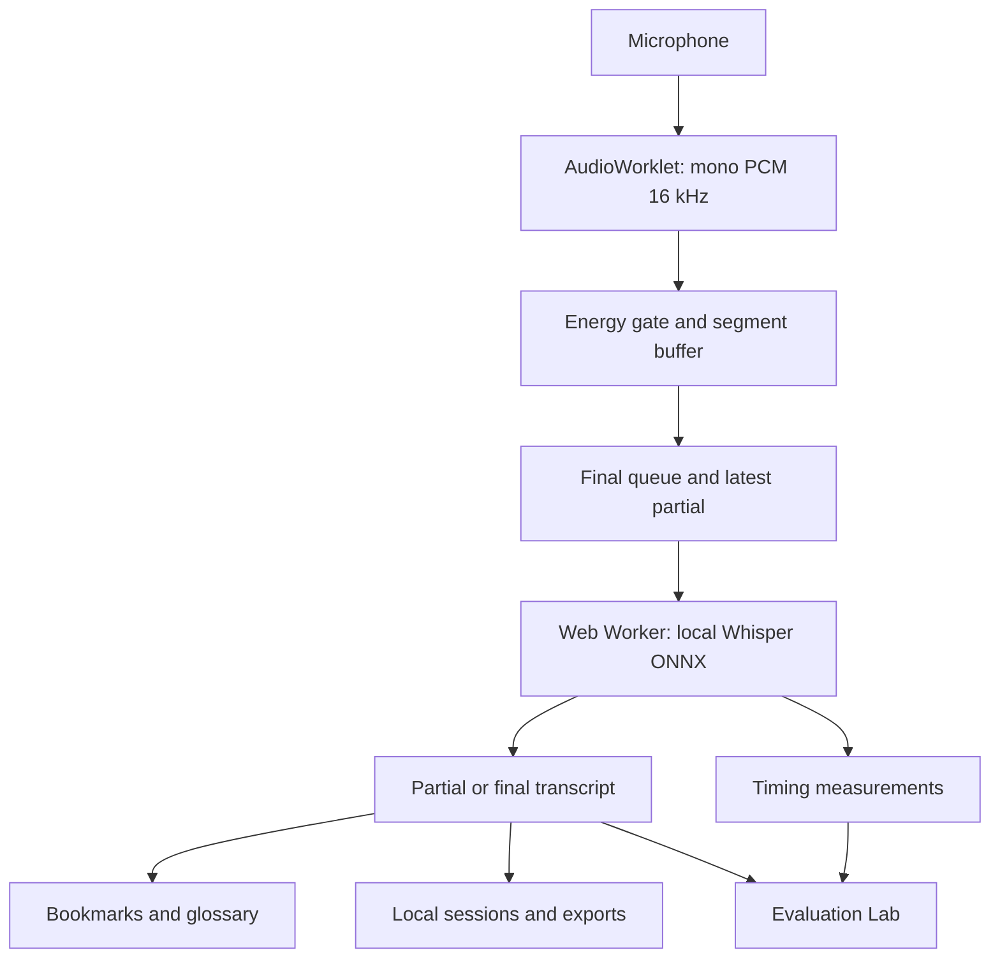

# Desain dan implementasi TechCaption

## Keputusan arsitektur

TechCaption menargetkan mahasiswa CS yang kesulitan mengikuti istilah teknis sambil mencatat penjelasan. Hasil yang ingin diuji: pengguna dapat mengikuti teks selama kuliah, menandai konsep penting, dan meninjau kembali transkrip setelah sesi.

Aplikasi adalah React + TypeScript + Vite statis. Browser pengguna menangkap audio dan menjalankan Whisper ONNX melalui Transformers.js. Hosting Vercel menyajikan HTML, JS, CSS, font, dan audio worklet. Tidak ada endpoint transkripsi, database server, biaya speech API, atau kunci rahasia.

## Alur audio

1. `getUserMedia` hanya meminta audio. Pengguna harus memberikan izin. Parameter browser meminta mono, echo cancellation, noise suppression, dan auto gain; implementasi browser dapat berbeda.
2. `AudioContext` meminta sample rate 16 kHz. AudioWorklet merata-ratakan kanal dan melakukan resampling streaming jika sample rate aktual berbeda.
3. Frame keluar berisi 1.600 sampel float32, atau 100 ms pada 16 kHz. Sisa frame dikirim saat `flush`.
4. RMS energi menentukan apakah frame dianggap mengandung ucapan. Ini adalah energy gate sederhana, bukan neural VAD. Threshold dapat diubah sebelum sesi.
5. Buffer menyimpan hingga 300 ms pre-roll. Segmen diakhiri ketika terdapat 800 ms hening atau panjangnya mencapai 12 detik. Potongan dengan voiced duration kurang dari 150 ms diabaikan.
6. Setiap sekitar 2 detik audio segmen, snapshot sementara dijadwalkan. Saat tersedia cukup suara, inference dilakukan **sebelum sesi berakhir**.
7. Sebuah segmen memiliki ID stabil. Hasil partial mengganti teks pada ID itu; hasil final mengunci teks segmen tersebut. Hal ini mencegah duplikasi akibat append hasil partial berulang.
8. Queue memprioritaskan final. Snapshot partial yang belum diproses diganti dengan snapshot terbaru. Hanya satu inference berjalan sekaligus.
9. Ketika 3 final tertinggal dalam queue, input berhenti otomatis dan final yang sudah diterima diproses. Teks peringatan menjelaskan perangkat tidak dapat mengikuti audio.
10. Tombol Akhiri sesi mengirim flush, melepaskan mikrofon dan AudioContext, menjadwalkan final, lalu menunggu queue selesai. Error/timeout melepaskan resource dan mempertahankan teks yang sudah ditampilkan; audio belum terproses tidak disimpan.

Resampler fallback menggunakan rata-rata berbobot per sample interval. Ini bukan filter anti-alias berkualitas studio. Browser biasanya telah menyesuaikan sample rate karena AudioContext meminta 16 kHz; perilaku aktual tetap perlu diuji pada target device.

## Local ASR

| Parameter       | Nilai                                                                 |
| --------------- | --------------------------------------------------------------------- |
| Engine          | Transformers.js 4.3.1                                                 |
| Model ringan    | onnx-community/whisper-tiny                                           |
| Revisi Tiny     | ff4177021cc41f7db950912b73ea4fdf7d01d8e7                              |
| Alternatif      | onnx-community/whisper-base                                           |
| Revisi Base     | 1846881b6b3a3024392c1eea3ad983695bc23925                              |
| WASM            | q8, satu thread                                                       |
| WebGPU          | encoder fp32, decoder merged q4                                       |
| Bahasa          | indonesian / english                                                  |
| Decoder         | task transcribe, greedy (1 beam), do_sample false, maksimal 192 token |
| Batas inference | 120 detik; timeout adalah error, bukan target latency                 |
| Batas loading   | 5 menit; dapat dibatalkan dan dicoba kembali                          |

Revisi model dipin untuk konsistensi eksperimen. Pipeline mengekstrak fitur log-Mel dan menggunakan encoder-decoder Whisper. Tidak ada pelatihan dari nol atau fine-tuning pada versi ini.

Model dan runtime diunduh ke browser; inference tidak memakai server pihak ketiga. Memanggil Hugging Face untuk mengunduh berkas ONNX berbeda dari memanggil external ASR API. Audio berada di Float32Array dalam memori. Tidak ada panggilan `SpeechRecognition`/`webkitSpeechRecognition`.

Mode otomatis mencoba WebGPU lalu WASM jika loading GPU gagal. Runtime GPU dapat tetap gagal saat inference; pesan error mengarahkan pengguna mencoba CPU. Model/ukuran/bahasa tidak dapat diubah selama sesi aktif.

## Interpretasi real-time

Whisper bukan model streaming native. Wrapper ini memakai _incremental chunked inference_: model melihat snapshot ucapan yang semakin panjang, lalu memperbarui teks saat pengguna masih berbicara. Tidak perlu menunggu seluruh sesi selesai. Keberhasilan memenuhi latency yang dibutuhkan kelas harus dibuktikan dengan perangkat target dan audio nyata.

Kata yang berada tepat di batas maksimum 12 detik dapat terpotong karena versi ini tidak memakai overlap lintas segmen. Penyempurnaan berikutnya yang masuk akal adalah stable-prefix decoding/local agreement dengan overlap dan word timestamps. Tidak boleh mengklaim pendekatan tersebut telah diimplementasikan.

## Metrik

- `inferenceMs`: waktu di worker dari sebelum pipeline dipanggil sampai teks hasil tersedia.
- `queueMs`: waktu dari snapshot selesai ditangkap sampai dikirim ke worker.
- `updateDelayMs`: waktu dari sampel terakhir snapshot diterima di main thread sampai hasil kembali ke main thread. Termasuk queue, komunikasi dan inference; tidak termasuk delay hardware/browser sebelumnya.
- `firstTextMs`: waktu dari perkiraan awal segmen audio sampai hasil pertama yang tidak kosong pada segmen tersebut.
- `rtf`: inferenceMs / durasi audio snapshot dalam milidetik.
- Median/P95 memakai metode nearest-rank. Nilai kosong ditampilkan sebagai `—`, bukan angka yang dibuat-buat.

RTF snapshot bukan RTF seluruh aplikasi karena audio partial diproses berulang. Untuk menghitung beban total: jumlah semua inferenceMs / durasi unik audio sesi dalam ms. Untuk end-to-end perceived latency, tambah eksperimen berpenanda waktu audio/screen recording yang diselaraskan.

WER dihitung lewat Levenshtein word-level dan backtrace S/D/I. Teks dinormalisasi NFKC, lowercase, tanda baca diganti spasi kecuali + dan #. Hasil dapat >100%. Referensi kosong ditolak. Maksimal 1.500 kata per pengukuran untuk membatasi matriks DP.

Technical Term Error Rate pada versi ini = jumlah kemunculan istilah referensi yang rentang alignment-nya berisi substitusi, penghapusan atau penambahan internal / jumlah kemunculan istilah referensi. Pencocokan longest-first, tidak overlap. Jika tidak ada istilah, hasil N/A. Nama metrik ini harus selalu disertai definisi karena bukan satu standar universal.

## Data

- Sesi: metadata model, revisi, device, raw segments, bookmarks, metrics, notes.
- Glosarium: maksimal 150 istilah dan definisi.
- Evaluasi: reference, hypothesis, kondisi, kode sampel, WER/alignment/term errors.
- Feedback: kode peserta, task, empat rating, observasi, feedback.

Semuanya di localStorage, tidak terenkripsi dan tidak disinkronkan. Profil browser bersama berarti data dapat dibaca pengguna profil itu. Limit aplikasi: 100 sesi, 200 evaluasi, 200 feedback; quota aktual browser dapat habis lebih dahulu. Error storage ditampilkan dan arsip TXT/JSON tetap dapat diekspor dari sesi di memori.

Data sesi divalidasi dengan Zod. React merender teks biasa, tanpa `dangerouslySetInnerHTML`. Ekspor CSV mengutip sel dan menetralkan awalan formula. Vercel mengatur nosniff, deny framing, referrer policy, dan pembatasan permission kamera/geolokasi. Tidak ada analytics atau Google Fonts request; font dibundel lokal.

## UI/UX

Prioritas visual: judul dan isi transkrip → kontrol mikrofon → pilihan model → informasi tambahan. Navigasi desktop di sidebar dan mobile di bottom bar. Warna dasar ivory, teks charcoal/olive, aksen terracotta. Display memakai Manrope, body DM Sans, waktu memakai monospace.

Studio membedakan standby/loading/ready/listening/finishing/stopped/error. Data demo diberi label dan tidak masuk evaluasi otomatis. Transcript sementara ditandai, bookmark memakai state tombol, dan mode fokus memperbesar caption. Teks bantuan menjelaskan unduhan awal, local privacy, dan kendala inference.

Layout memiliki breakpoint 1.200, 1.000, 780, dan 560 px. Keyboard focus, skip link, input label, transcript live region, reduced motion, dialog konfirmasi hapus, dan print stylesheet tersedia. Rendering visual dan aksesibilitas dengan pembaca layar tetap perlu diperiksa pada browser nyata.
